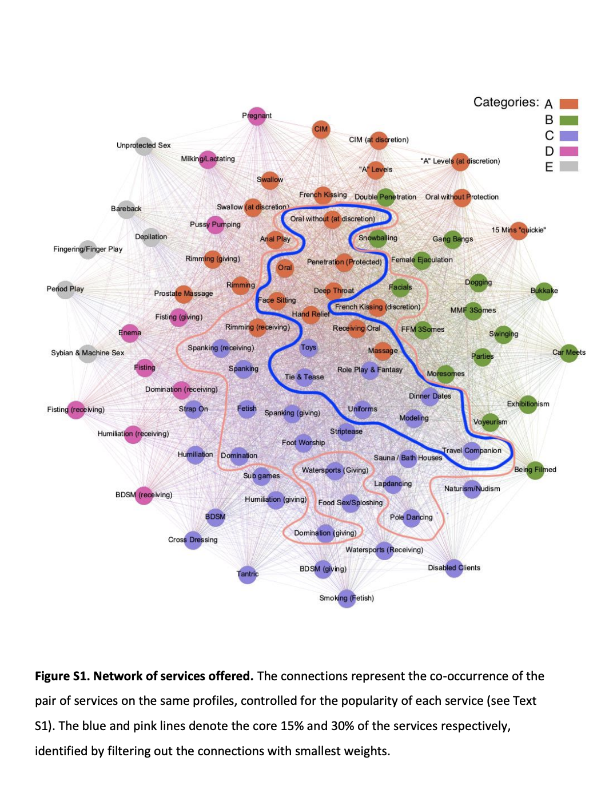
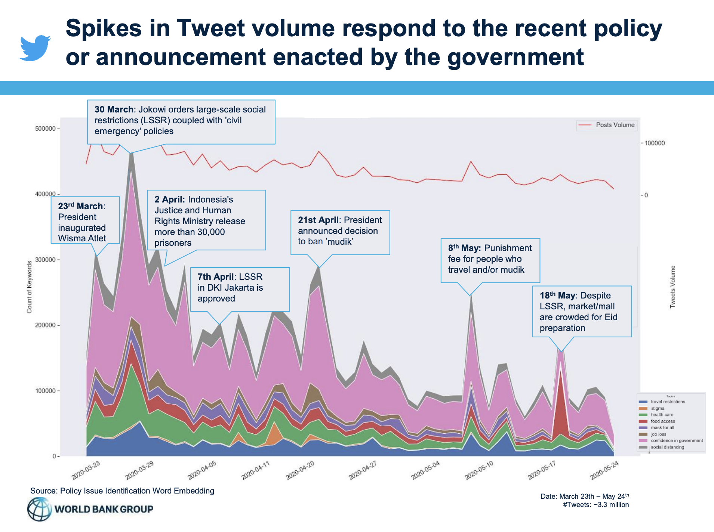

Here's a quick look at some of the projects and research I've been a part of. Feel free to reach out with any questions!

### InterviewQuery (2022)

["InterviewQuery Stats and A/B Testing Course"](https://www.interviewquery.com/courses/data-science-course/lessons/statistics-and-ab-testing/ae12a01d-3419-430e-8e73-a53f1e49d509 "InterviewQuery Stats and A/B Testing Course")

* I write curriculum and content to help data scientists get jobs! I've also done some work on how data scientists progress through different technical questions and larger questions about career progression in data science.

### Oxford Internet Institute  (2021)

["Selling sex: what determines rates and popularity?"](https://pubmed.ncbi.nlm.nih.gov/33882783/ "Link to Master's Thesis")

* Master's thesis, published in Culture, Health & Sexuality (2021). I analyzed rate-setting of sex workers using 11,500 scraped profiles on the UK's largest sex work marketplace.

* Methods: 

* Conclusions:

### World Bank/MIT IDSS (2020)

["World Bank Group Social Media Monitoring"](https://thedocs.worldbank.org/en/doc/984511610628201520-0070022021/original/IndonesiaSocialMediaMonitoringRound1.pdf "World Bank Group Social Media Monitoring")

* As part of a team collaborating with World Bank Group, Stanford, and MIT IDSS, we monitored national sentiment and popular concerns around COVID-19 across Indonesia.

* Methods: We used BERT 

* Conclusions:

* Analyzed  political polarization in the Indonesian presidential election in 2019.  Paper shortlisted for the Annual Bank Conference on Development Economics (ABCDE).

<embed src= "./assets/img/Indonesia_Polarization_ABCDE.pdf" type="application/pdf" />

* Methods: Used 

* Conclusions:

### DataKind UK (2020)

["Helping with CAP"](https://datakind.org.uk/portfolio-item/helping-with-cap/ "Helping with CAP")

["What's Data Got to Do With It?"](https://capuk.org/connect/keep-up-to-date/blog/whats-data-got-to-do-with-it "CAP Blog Post")

* Co-led a team of data scientists to find out pain points in the operations at CAP, a debt-counseling charity. 

### Me and My Big Data (University of Liverpool) (2020)
["Me and My Big Data Project"](https://www.liverpool.ac.uk/humanities-and-social-sciences/research/research-themes/centre-for-digital-humanities/projects/big-data/ "Me and My Big Data Project")

* I used factor analysis and other psychometric techniques to find predictors of digital literacy in the UK. Contributed to the "Me and My Big Data Project".

* Methods: 

* Conclusions:

### CorrelationOne (2020)

* Project lead for analysis of political tweets in the UK during COVID-19.

* Methods: 

* Conclusions:

