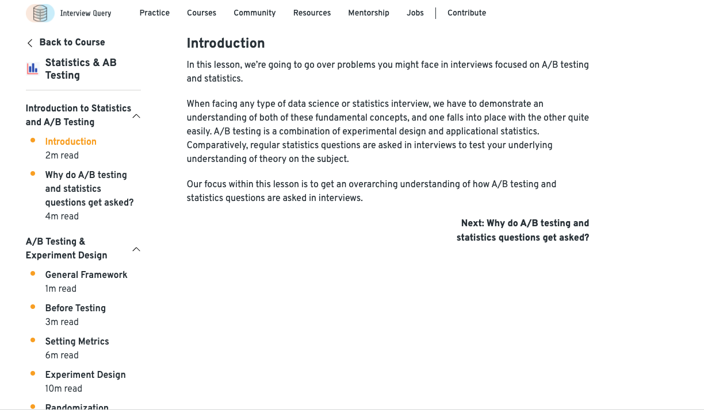
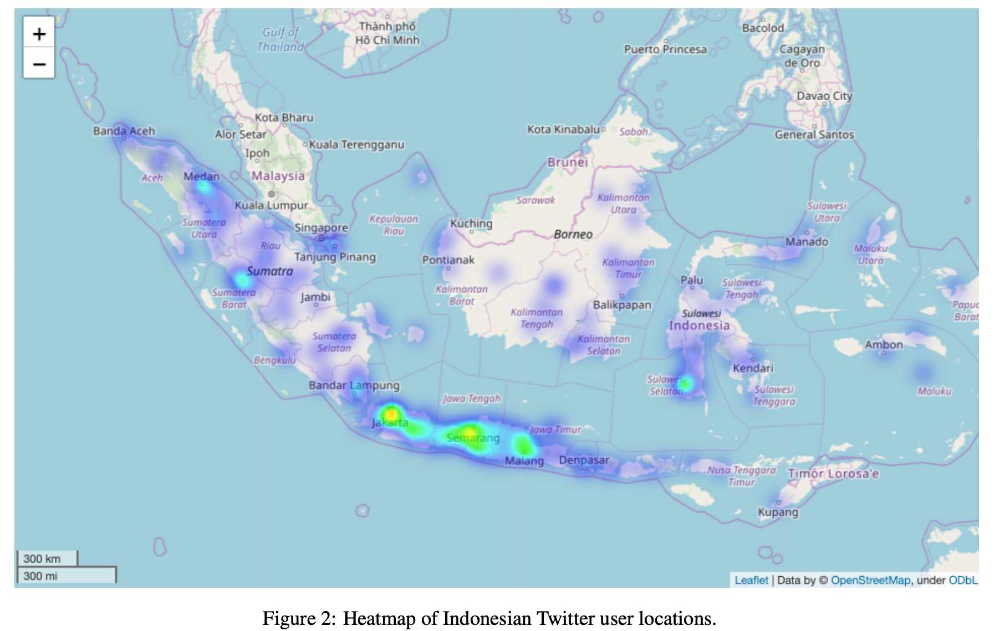
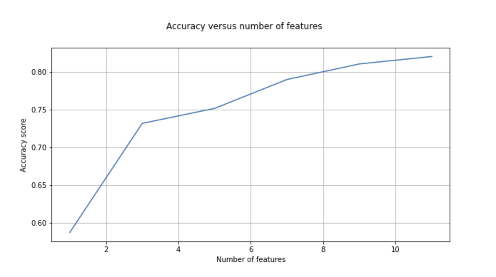
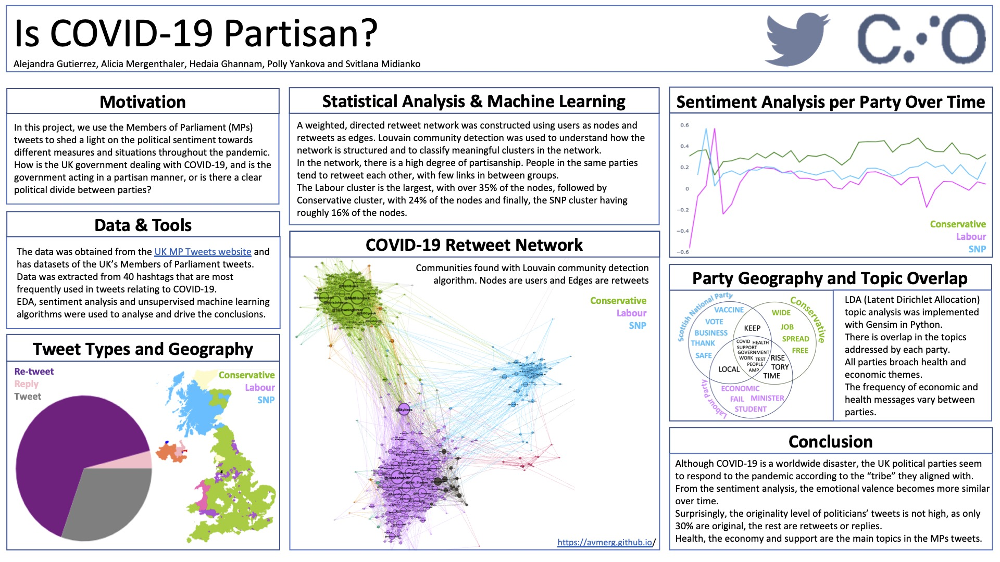

Here's a quick look at some of the projects and research I've been a part of. Feel free to reach out with any questions!

### ["InterviewQuery: Stats and A/B Testing Course" (2022)"](https://www.interviewquery.com/courses/data-science-course/lessons/statistics-and-ab-testing/ae12a01d-3419-430e-8e73-a53f1e49d509 "InterviewQuery Stats and A/B Testing Course"

I write curriculum and content to help data scientists get jobs! I've also done some work on how data scientists progress through different technical questions and larger questions about career progression in data science.

### ["Oxford Internet Institute: "Selling sex: what determines rates and popularity?" (2021)"](https://pubmed.ncbi.nlm.nih.gov/33882783/ "Link to Master's Thesis")

["How sex work has been affected by the pandemic"](https://theconversation.com/how-sex-work-has-been-affected-by-the-pandemic-160736 "How sex work has been affected by the pandemic")

This is the article from my Master's thesis, published in Culture, Health & Sexuality (2021). I analyzed rate-setting of sex workers using 11,500 scraped profiles on the UK's largest sex work marketplace. Nationality, gender, and the nature of services offered were strongly associated with price. As part of the research, I used network analysis, community detection, and cosine similarity metrics to find common 'baskets' of services offered by sex workers. The dataset I created for this research exists publically on the Harvard Dataverse: 
https://dataverse.harvard.edu/dataset.xhtml?persistentId=doi:10.7910/DVN/OMCDPI.

### ["World Bank Group/MIT IDSS: Social Media Monitoring (2020)"](https://thedocs.worldbank.org/en/doc/984511610628201520-0070022021/original/IndonesiaSocialMediaMonitoringRound1.pdf "World Bank Group Social Media Monitoring")

As part of a team collaborating with World Bank Group, Stanford, and MIT IDSS, we monitored national sentiment and popular concerns around COVID-19 across Indonesia. We found that conversations around government trust and economic security were especially prevalent in the early pandemic. Methods I used included topic analysis (LDA, dynamic topic analysis, BERT word embeddings), and sentiment analysis. I also created data pipelines to feed into an interactive Streamlit dashboard. This dashboard served as a template and was replicated in other countries as part of the Data Development partnership initiative.  

### World Bank Group: Polarization in Indonesian Social Media (2020)

As part of the World Bank Group team, I analyzed  political polarization in the Indonesian presidential election in 2019. We constructed a social graph of the interactions between followers of the two candidates, Prawbowo and Jokowi, and found polarization and low degrees of information flow between sides. We saw mapped Twitter activity over time and across geographies in Indonesia at the time of the election. Our paper was shortlisted for the Annual Bank Conference on Development Economics (ABCDE) in 2020. 

[download pdf](./assets/img/Indonesia_Polarization_ABCDE.pdf) 

### ["DataKind: Helping with CAP" (2020)](https://datakind.org.uk/portfolio-item/helping-with-cap/ "Helping with CAP")

["What's Data Got to Do With It?"](https://capuk.org/connect/keep-up-to-date/blog/whats-data-got-to-do-with-it "CAP Blog Post")

I co-led a team of data scientists to find out pain points in the operations at CAP, a debt-counseling charity. We used interpretable machine learning methods to find out indicators of higher-than-expected workload, measured the success of chase procedures, and predicted the route a client would take given a limited amount of information.

### [University of Liverpool: "Me and My Big Data Project" (2020)](https://www.liverpool.ac.uk/humanities-and-social-sciences/research/research-themes/centre-for-digital-humanities/projects/big-data/ "Me and My Big Data Project")

As a statistician on this project, I investigated digital literacy and potential harms from digital technology in the UK. I contributed to the "Me and My Big Data Project", where I helped developed profiles of different data users and consumers in the UK. For this work, I primarily worked with survey data and used factor analysis and other psychometric techniques, as well as regression and decision trees (R). 

### CorrelationOne: DS4A (2020)

I led a project to analyze of political tweets in the UK during COVID-19. We found that political figures typically amplified information about COVID-19 disseminated by their own parties, and that news outlets (with the exception of Sky News) were balanced between political affiliations in the network. For this project, I used networkX, Gephi, and the Twitter API.

